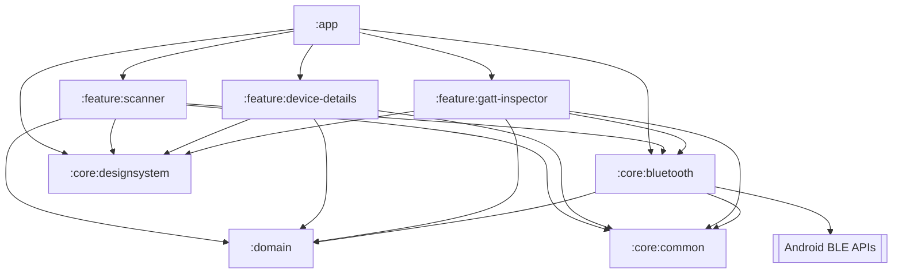
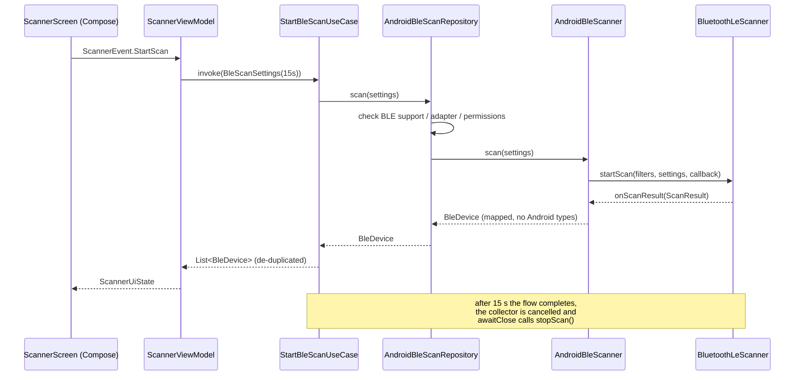
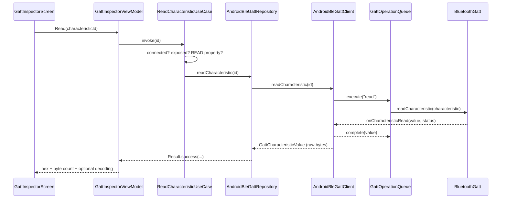

# MyBleSense

An Android app that scans for nearby **Bluetooth Low Energy** peripherals, shows what they
advertise (name, signal strength, service UUIDs, manufacturer data, service data, TX power) and —
since Phase 2 — connects to them and inspects their **GATT** database: services, characteristics,
properties, reads, writes and notifications.

It is a generic BLE tool: nothing in it is specific to a vendor or to a particular peripheral. See
[Phase 1 vs Phase 2](#phase-1-vs-phase-2) for what each phase added.

| | |
|---|---|
| Language | Kotlin 2.4, Coroutines + Flow |
| UI | Jetpack Compose, Material 3 |
| Architecture | Clean Architecture, multi-module, unidirectional data flow |
| DI | Hilt (KSP) |
| Build | AGP 9.4 / Gradle 9.7, version catalog, convention plugins |
| SDK | minSdk 26, target/compile 37 |

---

## Architecture

Three layers, strictly separated by Gradle modules. Dependencies only ever point inwards, towards
`:domain`.



### Modules

| Module | Responsibility | Knows about Android? |
|---|---|---|
| `:app` | Application, Hilt setup, navigation host, wiring the features together | yes |
| `:feature:scanner` | Scanner screen, ViewModel, UI state, permission/enable-Bluetooth flows, known device entry (startup auto-connect) | yes |
| `:feature:device-details` | Details screen, advertising presentation, connect/disconnect, **owns the lifetime of the links it opens** | yes |
| `:feature:gatt-inspector` | Services/characteristics UI, read / write / notify actions, raw value presentation | yes |
| `:core:bluetooth` | `BluetoothLeScanner`, `ScanCallback`, `BluetoothGatt`, `BluetoothGattCallback`, the GATT operation queue, adapter state, permission checks, advertising parsing | yes |
| `:core:datastore` | Preferences DataStore implementation of `KnownDeviceRepository` (device id + name only) | yes |
| `:core:designsystem` | Material 3 theme, shared Compose primitives, error copy | yes (Compose only) |
| `:core:common` | Hex/MAC formatting, logging facade, dispatcher qualifiers | yes (minimal) |
| `:domain` | Models, repository/scanner/GATT interfaces, use cases, de-duplication, sorting and operation rules | **no — plain Kotlin JVM module** |

`:domain` is a `java-library`/Kotlin JVM module: it *cannot* reference `BluetoothDevice`,
`ScanResult`, `BluetoothGatt`, `Context` or Compose, because the Android SDK is not on its compile
classpath. The
layering rule is enforced by the build, not by convention.

---

## BLE scanning flow



Key point: `AndroidBleScanner.scan()` is a **cold flow built with `callbackFlow`**. Collecting it
starts the platform scan; cancelling the collection stops it and unregisters the `ScanCallback` in
`awaitClose`. There is no `stopScan()` in the public abstraction because the lifetime of the scan
*is* the lifetime of the coroutine — a leaked scan callback is structurally impossible.

### Scan lifecycle

A scan stops when any of these happens:

| Trigger | Mechanism |
|---|---|
| User taps **Stop scan** | `scanJob.cancel()` |
| 15 s timeout | the use case's `takeFor(duration)` completes the flow |
| Screen goes to the background | `LifecycleEventEffect(ON_STOP)` → `StopScan` |
| ViewModel cleared | `viewModelScope` cancellation |
| Bluetooth turned off | adapter-state flow merged into the scan flow fails it |
| Permissions revoked | re-checked on `ON_START`, scan stopped |
| Scanner error | `onScanFailed` closes the flow with a `BleException` |

Scanning never restarts by itself when Bluetooth comes back — the user starts the next scan.

---

## BLE GATT

### GAP vs GATT

Two different jobs, often confused:

| | GAP | GATT |
|---|---|---|
| Question it answers | "who is out there?" | "what can this device do?" |
| Works over | advertising packets, no connection | an established connection |
| Phase | 1 (scanner) | 2 (inspector) |
| Data | ≤ 31 bytes of advertising data, broadcast to everyone | a structured database, read/written per request |

A peripheral advertises (GAP) so that a central can find it; once the central connects, everything
else happens through GATT.

### Client and server

The **server** is the device that owns the data — the peripheral (a watch, a sensor, an ESP32).
The **client** is the device that asks for it — this app. Note the inversion compared to the usual
client/server intuition: the phone is the more powerful machine, but it is the *client*.

### Services, characteristics, properties

```text
Device
└── Service            "Battery Service" (180F)      a logical group of related data
    └── Characteristic "Battery Level"  (2A19)       a single value, with metadata
        ├── properties READ | WRITE | WRITE_NO_RESPONSE | NOTIFY | INDICATE
        ├── value      raw bytes (4C)
        └── Descriptor CCCD (2902)                   the notification on/off switch
```

Bluetooth SIG UUIDs are 16-bit values transported inside the base UUID
`0000xxxx-0000-1000-8000-00805F9B34FB`, which is why the UI shows `180F` rather than the full form.
Vendor specific services use full 128-bit UUIDs and have no assigned name; the app displays those
UUIDs as they are instead of guessing (`BluetoothSigNames` only knows a small, standard subset).

**Properties are a contract, not a suggestion**: every action the inspector offers is derived from
the properties the peripheral declares. A characteristic without `WRITE`/`WRITE_NO_RESPONSE` gets
no write field, and the write mode is chosen from the properties rather than by the caller —
`WRITE` waits for the peripheral's acknowledgement, `WRITE_NO_RESPONSE` does not.

### Read, write, notify, indicate

| Operation | Who starts it | Acknowledged | Used for |
|---|---|---|---|
| Read | client | yes | one-off values (battery level, firmware revision) |
| Write | client | yes | commands that must not be lost |
| Write without response | client | no | high-rate, loss-tolerant streams |
| Notify | **server** | no | values that change over time (heart rate) |
| Indicate | **server** | yes | rare, important updates (service changed) |

Notifications and indications are the same idea with different reliability, and both are switched
on the same way — by writing the **CCCD**, the Client Characteristic Configuration Descriptor
(`2902`): `01 00` enables notifications, `02 00` enables indications, `00 00` disables both.
Android needs *two* steps and both are easy to forget:

```kotlin
gatt.setCharacteristicNotification(characteristic, true)  // local: deliver the callbacks to us
gatt.writeDescriptor(cccd, ENABLE_NOTIFICATION_VALUE)     // remote: ask the peripheral to send
```

Calling only the first one is the classic "notifications don't work" bug: the app is listening,
but the peripheral was never asked to talk.

### Connection lifecycle

```text
DISCONNECTED ──connect()──► CONNECTING ──onConnectionStateChange(CONNECTED)──► CONNECTED
     ▲                          │                                                  │
     │                          │ timeout / status ≠ 0                             │ discoverServices()
     │                          ▼                                                  ▼
     └──────────── close() ── failure                                    CONNECTED + services
     ▲                                                                              │
     └── DISCONNECTING ◄── disconnect() ────────────────────────────────────────────┘
```

Failures are **not** connection states: a failed attempt ends in `DISCONNECTED` and the reason
travels as a `BleError`, so a transient error can never wedge the state machine. Unsolicited
failures (link lost, Bluetooth switched off, permission revoked) arrive on a separate error stream.

Whatever the exit path — user disconnect, connection failure, timeout, adapter switched off,
leaving the screen — teardown goes through a single `release()` that closes `BluetoothGatt`,
cancels the adapter watchdog, terminates the operation queue and clears the exposed flows. Android
allows a limited number of GATT client interfaces per app, so a `BluetoothGatt` that is never
`close()`d eventually makes every later connection fail with the infamous status 133.

### Who owns the connection

The connection lives in an **app-scoped** `AndroidBleGattClient`, not in a ViewModel, so that
navigating from the details screen to the inspector (or rotating the phone) does not drop and
reopen the link. **Whoever opens a link closes it:**

* `DeviceDetailsViewModel` closes a link *it* opened in `onCleared`, i.e. when the details screen
  leaves the back stack — which is exactly "the user left the connection flow", and is not
  triggered by a configuration change. A link it did not open (the device list's) is left open;
  only the POC Events subscription it made is switched off.
* `ScannerViewModel` owns the link it opens to the known device (see
  [Known device](#known-device)) and closes it in its own `onCleared`, when the app's task goes
  away. It never reconnects on its own after a loss.

At most one connection exists at a time; connecting elsewhere closes the previous one first.

A link the user opened from the details screen that is lost **unexpectedly** (out of range,
peripheral reset) is restored by `ReconnectToDeviceUseCase`: at most 3 attempts with exponential
back-off (1 s, 2 s, 4 s), which also rediscovers services and — through the details ViewModel —
re-subscribes to the POC Events characteristic. It gives up at once on failures retrying cannot fix
(Bluetooth off, permission revoked), and is cancelled by an explicit disconnect or by leaving the
screen. A user-requested disconnect never triggers it: the GATT client only reports unexpected
losses on its error stream.

### Known device

The last device the app connected to successfully is remembered across launches, so the device
list can show it — and connect to it — without a scan.

* **Model and storage.** `KnownDevice(id, name)` in `:domain`; `KnownDeviceRepository` is
  implemented in `:core:datastore` with a Preferences DataStore holding two strings. No Android
  Bluetooth/GATT object is persisted. An unreadable file reads as "no known device".
* **Remembering.** `TrackKnownDeviceUseCase` runs in the application scope (started from
  `MyBleSenseApplication`). Every connection that reaches "services discovered" — whichever screen
  opened it, reconnections included — replaces the known device. The name comes from the scan
  session, or the entry already remembered for that id. A scan that sees the known device updates
  its entry (new name) instead of adding another.
* **Startup.** The scanner shows a "Known device" card above the scan controls as soon as the entry
  is read. It connects automatically **once per screen lifetime**, only when Bluetooth is supported,
  on and permitted and no link is open (`shouldAutoConnect` in `:domain`). An automatic failure is
  quiet (the card turns "Unavailable" and says why); a manual one is also shown as a snackbar.
* **Status.** Derived in `KnownDeviceMapper.kt` from the client's `connection`, adapter state,
  permission, the current scan and the last attempt: `Connected`, `Connecting…`, `Disconnecting…`,
  `Available` (seen by this scan, with RSSI), `Unavailable` (last attempt failed, or a finished scan
  did not see it), `Disconnected` (not checked yet), `Bluetooth is off`, `Permission required`.
* **No duplicates.** A scan result with the known id is removed from the list (`otherDevices`) and
  merged into the card. The manual scan is unchanged.
* **Details without a scan.** The details screen falls back to the known device when the scan
  session does not have it; advertising fields are shown as not available.
* **Forget device.** The card's "Forget device" action (`ScannerEvent.ForgetKnownDevice`) runs
  `ForgetKnownDeviceUseCase`: a link to the known device that is open or opening is disconnected
  first (an attempt in flight is cancelled), then `KnownDeviceRepository.clear()` removes both
  strings. The card disappears and the list is back to first-launch behaviour — the next manual
  scan lists the device like any other, and nothing auto-connects to it. Only the app's record is
  removed; the Android Bluetooth pairing is left untouched. It runs in the application scope, so
  leaving the screen midway cannot leave the device disconnected but still remembered. A failed
  disconnect or storage write keeps the device (`BleError.KnownDeviceNotForgotten`). Connecting to
  it again remembers it again.

### GATT operation serialization

Android's GATT stack accepts **one outstanding request per connection**. A read issued while a
write is still waiting for its callback is rejected — or silently dropped, which is worse.
`GattOperationQueue` therefore holds a fair mutex across the whole "start the operation, wait for
its callback" window:

```text
     read 2A19 ──┐
    write FFE1 ──┼─► [ mutex ] ─► start op ─► await callback (≤ 10 s) ─► result
  CCCD 2A37 on ──┘
```

The parts that keep it from deadlocking — the usual fate of hand-written GATT queues:

* the callback is awaited under `withTimeout`, so a peripheral that never answers releases the
  lock instead of blocking every later operation;
* the pending continuation is cleared in a `finally`, so a failed, timed out or cancelled
  operation never leaves a stale deferred behind;
* `close()` terminates the queue on disconnect: the in-flight operation fails and everything still
  queued fails fast instead of being sent to a dead `BluetoothGatt`;
* notifications never touch the queue — they are unsolicited and would otherwise complete an
  unrelated operation.

### From callback to Compose

```text
BluetoothGattCallback      (binder thread, :core:bluetooth)
        ↓                  StateFlow / SharedFlow / CompletableDeferred
AndroidBleGattClient       one connection, one operation queue
        ↓                  BleGattClient  (interface, :domain)
AndroidBleGattRepository   preconditions, failures → Result<T>
        ↓                  BleGattRepository (interface, :domain)
Use cases                  property checks, write-mode choice, filtering
        ↓                  StateFlow / Flow / suspend
GattInspectorViewModel     immutable UI state
        ↓                  collectAsStateWithLifecycle
Compose UI
```

No Android Bluetooth type crosses the `:core:bluetooth` boundary, and no callback is ever exposed
above it: state is a `StateFlow`, streams are a `Flow`, one-shot operations are `suspend`
functions.

### GATT inspector flow



---

## Raw values and decoding

Values are raw bytes and are shown as such: hexadecimal, plus the byte count and the time they
arrived. On top of that the UI *may* add an interpretation, always labelled as one:

* **Decoded** — only for characteristics whose format the Bluetooth SIG defines (battery level,
  heart rate measurement, temperature, humidity, the standard string characteristics), and only
  when the payload has the expected length. A vendor characteristic is never decoded.
* **UTF-8 interpretation** — only when the bytes are printable text; arbitrary binary data is left
  alone rather than rendered as replacement characters.

Writes go the other way: hexadecimal input (`01 FF 2A`, `01:ff:2a`, `0x01FF2A`) is parsed into
bytes, and anything malformed — an odd number of digits, a non-hex character — is rejected with a
message instead of being partially parsed. A write is only ever sent when the user presses the
button.

---

## Permissions

| API level | Requested at runtime | Declared |
|---|---|---|
| 31+ | `BLUETOOTH_SCAN` (with `neverForLocation`), `BLUETOOTH_CONNECT` (also required to connect and to run GATT operations) | both |
| 26–30 | `ACCESS_FINE_LOCATION` (the platform gates scan results behind it) | plus install-time `BLUETOOTH`, `BLUETOOTH_ADMIN`, capped with `maxSdkVersion="30"` |

Location is never requested on modern Android, and scan results are never used to derive location.

```text
App opened → permissions checked (ON_START, every resume)
   granted ─────────────► Ready to scan
   missing ─────────────► "Grant permission" → system dialog
       denied ──────────► explanation + retry
       denied, no rationale ─► "Permission permanently denied" + Open settings
```

The distinction matters: a permission that was *never requested* also reports
`shouldShowRequestPermissionRationale == false`, so a permanent denial is only inferred from an
actual request result (`PermissionRequestCompleted`), never from a routine re-check
(`PermissionsChecked`).

---

## Advertising data parsing

`ScanResultMapper` is the only class that understands `ScanResult`/`ScanRecord`. It extracts:

* device name (from the advertisement first, the adapter cache only as a fallback),
* service UUIDs, shortened to their 16/32-bit form (`0000180d-0000-1000-8000-00805f9b34fb` → `180D`),
* manufacturer specific data, keyed by Bluetooth SIG company identifier (a small lookup resolves
  common vendors; the payload itself is **never** decoded, only shown as hex),
* service data,
* TX power (`ScanResult.txPower`, falling back to the `ScanRecord` AD structure),
* connectability.

Raw payloads are formatted once, in the presentation mappers — no parsing or formatting happens
inside a Composable.

---

## Duplicate handling

BLE peripherals advertise several times per second and `CALLBACK_TYPE_ALL_MATCHES` reports every
one of them. `DiscoveredDevices` is an immutable index keyed by the hardware address (names are
*not* unique and are never used as a key):

* unknown address → new entry, appended at the end,
* known address → the entry is **merged**: RSSI and changed advertising data are updated, a name
  learned earlier is kept when a later advertisement omits it, `firstSeenAtMillis` is preserved and
  the advertisement counter increases,
* discovery order is stable (`LinkedHashMap`), so rows never jump around, and the list uses stable
  Compose keys.

Sorting (signal strength / name / discovery order) lives in the domain layer as `Comparator`s.

RSSI is shown in dBm with a coarse Strong / Medium / Weak indicator. It is deliberately **not**
translated into a distance.

---

## Error handling

Infrastructure failures are mapped onto a sealed `BleError` before they leave `:core:bluetooth`:
`BleUnsupported`, `BluetoothDisabled`, `PermissionDenied`, `ScannerUnavailable`,
`ScanAlreadyStarted`, `ScanThrottled`, `ScanFailed(code)`, `BluetoothTurnedOffDuringScan`,
`Unknown`.

Phase 2 extends the same type with the connection-time failures: `DeviceNotFound`,
`ConnectionFailed(status)`, `ConnectionTimeout`, `Disconnected`, `NotConnected`,
`ServiceDiscoveryFailed`, `CharacteristicNotFound`, `CharacteristicOperationUnsupported`,
`DescriptorNotFound`, `CharacteristicReadFailed`, `CharacteristicWriteFailed`,
`NotificationEnableFailed`, `GattOperationTimeout`, `GattOperationRejected`,
`UnknownGattError(status)`.

Compose never sees a `SecurityException`, a GATT status code or a raw Android error code; a single
mapping function (`BleError.toUserMessage()`, in `:core:designsystem`) turns each error into
user-facing copy, so the same failure reads the same way on every screen. Status 133 is reported as
"could not connect" rather than as a number the user cannot act on.

---

## Privacy

The scan asks for `BLUETOOTH_SCAN` with `neverForLocation` on Android 12+, so no location
permission is requested and no location is derived from the results. The details screen is an
inspection tool: every advertised field, including the hardware address, is shown as received.
Verbose payload logging is limited to debug builds (`BleLog.isDebug = BuildConfig.DEBUG`).

---

## Testing

No test needs Bluetooth hardware. `FakeBleScanner` (published from `:domain` as test fixtures)
emits deterministic advertisements, and the scan timeout is exercised on the coroutine test
scheduler's virtual clock.

`FakeBleGattClient` does the same for the connection side: connections, reads, writes, CCCD
writes, notifications and every failure mode are driven by the test, never by a peripheral.

| Suite | What it covers |
|---|---|
| `:domain` (JVM) | de-duplication, RSSI updates, name/advertising merge, discovery order, sorting, signal buckets, scan start/stop, timeout completion, error propagation, session store |
| `:domain` touch & reconnect | TOUCH_ON/TOUCH_OFF pairing, unknown/negative durations, TOUCH_INTENSITY parsing (malformed/out of range), peak/average statistics and per-touch reset, per-connection tracker reset, back-off policy, retryable errors, reconnect success/retry/give-up/cancel |
| `:domain` GATT | initial disconnected state, connecting → connected, service discovery (populated, empty, unknown UUIDs), connection failure/timeout, disconnect, unexpected disconnect, read success/failure/timeout/while-disconnected, unknown characteristic, property validation for read/write/subscribe, write mode selection, notification enable/disable, notification streams, link lost while subscribed |
| `:core:bluetooth` | **operation queue**: sequential execution, second operation waits, failure does not block the queue, rejected operation, timeout without deadlock, disconnect clears pending and queued work; property bit-mask decoding, GATT status mapping, SIG UUID names, scan error codes |
| `:core:common` | hex formatting and parsing (valid, malformed, round-trip), printable-UTF-8 detection |
| `:domain` known device | scan-result merge, auto-connect policy (once, Bluetooth ready, idle link), remembering on connection, replacement by another device, name kept without a scan, scan update without duplicate, storage failure; forgetting (link closed first, other device's link kept, nothing to forget, storage failure), a forgotten device not re-saved by a scan but remembered again on connection |
| `:core:datastore` | real DataStore file: empty start, save/read back, replacement (name included), survives restart, observers, unreadable file, forget (name included, across restart) |
| `:feature:scanner` | ViewModel: initial state, start/stop, discovery, RSSI update without duplication, timeout, sorting, Bluetooth off mid-scan, no auto-restart, permission denial/permanent denial/revocation, scan failure, retry, session reset; known device shown without scan, single auto-connect, Bluetooth off / no permission, manual connect/failure/cancel, available vs unavailable, no duplicate, disconnect, lost link, ownership on teardown; forget (connected, disconnected, while connecting, listed again by a scan without auto-connect, storage failure, busy state ignores a second tap); status mapping |
| `:feature:device-details` | advertising, hardware event and connection-status mapping; ViewModel: connect state transitions, failure/timeout/service-discovery copy, double-connect ignored, disconnect, link lost, bounded reconnection (back-off, give up, cancel on disconnect/leave/Bluetooth off), subscription restored after reconnect, touch duration, live intensity and touch statistics, connection to another device, teardown on leaving the screen, known-device fallback, a link it did not open is kept |
| `:feature:gatt-inspector` | ViewModel: service naming and expansion, read value/decoding, read failure, valid and invalid hex writes, write failure, notification on/off, incoming values (newest first), subscription failure, disconnect clearing state; standard-characteristic decoding rules |
| Instrumented (Compose) | scanner list and states, known device card (connect, available without duplicate, open/disconnect, cancel, unavailable, Bluetooth off, forget, disabled while forgetting, forgotten device listed as a scan result); details rendering, connect/inspector actions; inspector services, characteristics, values, actions, disabled busy actions, unknown UUIDs, notification list, empty/discovering/disconnected states |

```bash
./gradlew test testDebugUnitTest      # 302 unit tests
./gradlew connectedDebugAndroidTest   # 40 Compose UI tests (API ≤ 36 emulator/device)
./gradlew lintDebug                   # static analysis
```

---

## Engineering highlights

* **Structured concurrency instead of manual teardown.** The scan's lifetime is a coroutine's
  lifetime: `callbackFlow` + `awaitClose` guarantee `stopScan()` runs on every exit path
  (stop, timeout, lifecycle, error, Bluetooth off). No `GlobalScope`, no leaked callbacks.
* **A domain layer that cannot cheat.** `:domain` is a plain Kotlin JVM module, so the "no Android
  types in the domain" rule is enforced by the compiler.
* **Bounded scanning by construction.** `BleScanSettings.duration` is part of the contract and the
  use case completes the flow when it elapses; there is no code path for an unbounded scan.
* **De-duplication as a pure, testable value type.** `DiscoveredDevices` is immutable and merges
  advertisements without losing previously learned data — tested independently of Android.
* **Two-signal permission model.** Distinguishing "never asked" from "don't ask again" avoids the
  common bug of showing users a dead-end settings prompt on first launch.
* **Adapter state merged into the scan.** Turning Bluetooth off during a scan fails the flow at the
  repository level, so every consumer is cancelled consistently instead of hanging silently.
* **Convention plugins.** Build logic lives in `build-logic/` (`myblesense.android.feature`,
  `myblesense.hilt`, …), so module build files stay a handful of lines each.
* **A GATT queue that cannot wedge.** Timeout, cancellation and disconnect all release the lock and
  clear the pending continuation, so one unanswered request cannot disable every later operation —
  the failure mode most hand-rolled BLE queues ship with.
* **One connection, one owner.** The link is app-scoped so navigation does not drop it, while its
  lifetime is pinned to a single ViewModel's `onCleared`; there is exactly one teardown path, and
  it always calls `close()`.
* **Capabilities drive the UI.** Read, write and subscribe actions exist only where the peripheral
  declares the matching property, and the write mode follows from it — the app never assumes what a
  device allows.

---

## Phase 1 vs Phase 2

| | Phase 1 | Phase 2 |
|---|---|---|
| Scope | discovery (GAP) | discovery **+** GATT client |
| Connection | none | one app-scoped connection, explicit connect/disconnect |
| Data | advertising payloads | services, characteristics, descriptors, live values |
| Actions | scan, sort, inspect advertisement | read, write (hex), enable/disable notifications |
| New modules | — | `:feature:gatt-inspector` |
| New infrastructure | — | `AndroidBleGattClient`, `GattOperationQueue`, GATT mappers, SIG names |

### Supported functionality

* Connect to and disconnect from a scanned device, with an explicit connection state.
* Remember the last connected device and show/connect to it at startup without a scan.
* Discover services and characteristics; standard UUIDs are named, unknown ones are shown as UUIDs.
* Read any characteristic that declares `READ`; raw hex, byte count, timestamp and — for standard
  characteristics — a labelled interpretation.
* Write hexadecimal values to characteristics that declare `WRITE` or `WRITE_NO_RESPONSE`, with
  input validation and the correct write mode.
* Enable/disable notifications or indications through the CCCD and watch incoming values arrive.
* Serialized GATT operations with timeouts, and graceful handling of disconnects, Bluetooth being
  switched off, revoked permissions and leaving the screen.

### Known limitations

* **One connection at a time**, by design; connecting elsewhere closes the previous link.
* **No bonding/pairing UI.** Characteristics that require authentication or encryption fail with
  "the device does not allow this operation"; the app does not initiate bonding.
* **No MTU negotiation**, so values longer than the default ATT payload (20 bytes) are truncated by
  the peripheral, and long writes are not split.
* **Reconnection is bounded and foreground only** (3 attempts, see
  [Who owns the connection](#who-owns-the-connection)); there is no background/foreground service:
  the connection ends when the connection flow is left. The startup connection to the known
  device is a single attempt.
* Descriptors other than the CCCD are not listed or read.
* The last 20 notifications per characteristic are kept, in memory only.
* The SIG name table is a small, curated subset, not the full assigned-numbers database.

### Garmin (and other vendor devices)

No vendor-specific logic exists anywhere in the app, and the Venu Sq used during development is
treated like any other peripheral. Expect vendor devices to:

* advertise and appear in the scanner, yet refuse a connection, or accept one and expose almost
  nothing;
* expose proprietary 128-bit services with no assigned names and undocumented payloads;
* require bonding, a companion app, or a vendor protocol for anything functional.

The inspector reports what the device actually exposes. A device being visible says nothing about
what it will allow.

### Phase 3 ideas

MTU negotiation and long reads/writes, descriptor browsing, bonding, notification history export,
multiple simultaneous connections, a deterministic ESP32 test peripheral (read/write/notify
characteristics) for end-to-end tests, and connection parameter/PHY inspection.

---

## Running it

```bash
./gradlew installDebug
```

Requires JDK 17+ (the build was verified with JBR 21) and an Android SDK with API 37 installed.
Grant the nearby-devices permission when asked, enable Bluetooth, then press **Start scan**.

Then: tap a device → **Connect** → **Open GATT Inspector** → expand a service → expand a
characteristic → **Read**, write a hex value, or switch notifications on. Leaving the details
screen disconnects.

BLE needs real hardware: the emulator has no Bluetooth adapter, so scanning and connecting only
work on a physical device. The unit and Compose tests, however, run anywhere.
